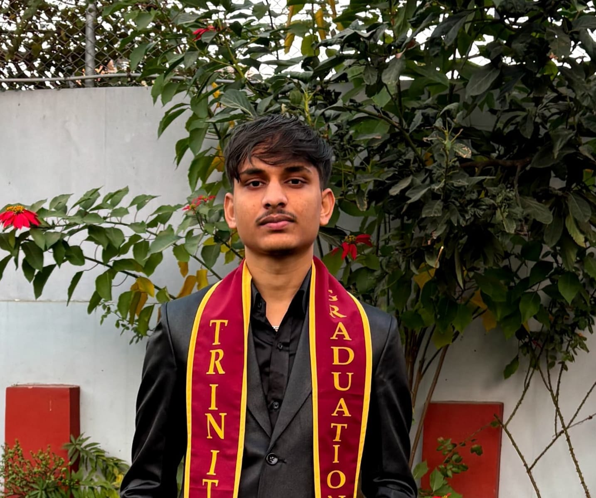

# Nausad Aalam | Personal Portfolio

<p align="center">
  
</p>

<h3 align="center">Chartered Accountancy Aspirant (ICAI) • +2 & SEE Graduate • Tech & Web Enthusiast</h3>

<p align="center">
  <a href="https://github.com/nausad24"></a>
  <a href="https://wa.me/9779816732482"></a>
  <a href="http://t.me/Na0241"></a>
  <a href="mailto:nausadalam9714@gmail.com"></a>
</p>

---

## 🌟 About Me

Welcome to my personal portfolio repository! I am **Nausad Aalam**, a Chartered Accountancy student pursuing the CA course under **The Institute of Chartered Accountants of India (ICAI)**. Originally from **Siraha, Nepal**, I combine a deep passion for financial accounting, corporate laws, and taxation with a strong interest in modern web design, software tools, and digital media production.

- 🎓 **Currently**: Pursuing **CA Intermediate** (Group 1 & Group 2) with ICAI
- 🏆 **Milestone**: Successfully cleared **CA Foundation** (January 2025)
- 📚 **Academic Roots**: Completed **+2 in Management/Commerce** and **SEE** from Shree Secondary School Ramaul Makhanaha, Manpur, Siraha
- 💻 **Tech Interests**: Modern Web Technologies, HTML5, CSS3, JavaScript, Git & GitHub
- 🎥 **Content Creation**: Sharing educational, motivational, and spiritual recitations on YouTube

---

## 🎓 Academic & Professional Journey

```
  [ SEE Graduate ] ──────► [ +2 Commerce/Mgmt ] ──────► [ CA Foundation (Cleared) ] ──────► [ CA Intermediate ]
Shree Secondary School,         Accounting, Economics,          ICAI (January 2025)                 ICAI (Present)
Siraha, Nepal                   & Business Studies                                          Tax, Law, Accounts, Costing
```

### 1. Chartered Accountancy (CA Intermediate)
* **Institution:** The Institute of Chartered Accountants of India (ICAI)
* **Status:** In Progress (Group 1 & Group 2 preparation)
* **Key Areas:** Advanced Accounting, Corporate and Other Laws, Direct & Indirect Taxation (GST/TDS), Cost and Management Accounting, Auditing & Ethics.
* **Foundation:** Cleared CA Foundation in January 2025.

### 2. Higher Secondary Education (+2 Commerce / Management)
* Built strong foundational expertise in double-entry bookkeeping, financial statements, commercial arithmetic, and business management.

### 3. Secondary Education Examination (SEE)
* **School:** Shree Secondary School Ramaul Makhanaha, Manpur, Siraha-4, Nepal.

---

## 🛠️ Skills & Expertise

### 💼 Finance & Corporate
- Financial Accounting & Reporting
- Corporate & Commercial Laws
- Direct & Indirect Taxation (GST, TDS, Income Tax)
- Cost & Management Accounting
- Auditing Principles & ICAI Standards

### 💻 Web & Technology
- HTML5, CSS3 (Modern Glassmorphism, Flexbox, CSS Grid, Cyber Aesthetics)
- JavaScript & Interactive DOM Manipulation
- Canvas 2D Graphics & Particle/Cursor Trail Animation
- Git & GitHub Version Control
- Responsive & Mobile-First Web Design

### 📊 Tools & Media
- ICAI Portals & Self-Service Portal (SSP)
- Microsoft Office (Excel, Word, PowerPoint)
- Video & Audio Editing (YouTube Shorts & Media Production)

---

## 🌐 Live Website & Portfolio Highlights

This portfolio features an immersive cyberpunk / dark-neon aesthetic:
- **Monogram Loading Screen:** Pure CSS animated `NS` logo with cyan-purple glowing ring.
- **Interactive Cursor Trail:** 28-point glowing ribbon canvas animation that follows user movements.
- **Dynamic Profile Card:** 3D tilt, holographic ambient backdrop, and avatar frame with rotating conic gradient ring.
- **Comprehensive Sections:** Navigation Bar, About Me, Academic Timeline, Skills Matrix, YouTube Media Showcase, and Contact Form.
- **Floating Contact Hub:** Quick-access Telegram and WhatsApp buttons.

---

## 🚀 How to Run Locally

1. **Clone the repository:**
   ```bash
   git clone https://github.com/nausad24/Nausadaalam_web.git
   cd Nausadaalam_web
   ```

2. **Open `index.html`:**
   Double click `index.html` or open with any modern web browser:
   ```bash
   # On Windows PowerShell
   Start-Process index.html
   ```

---

## 📬 Contact & Connect

- **Email:** [nausadalam9714@gmail.com](mailto:nausadalam9714@gmail.com)
- **WhatsApp:** [+977 9816732482](https://wa.me/9779816732482)
- **Telegram:** [@Na0241](http://t.me/Na0241)
- **GitHub:** [@nausad24](https://github.com/nausad24)
- **Location:** Siraha, Nepal / Kathmandu

---

<p align="center">
  <sub>Designed & Developed with ❤️ by <b>Nausad Aalam</b> • &copy; 2026 All Rights Reserved</sub>
</p>
